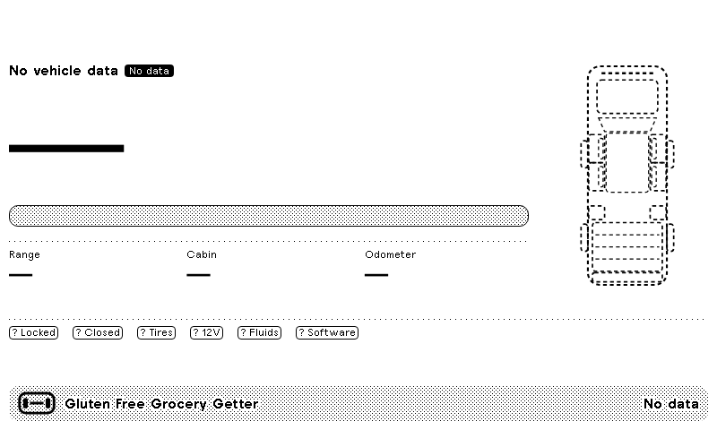
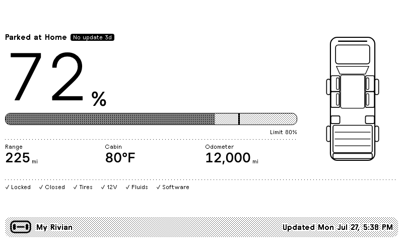
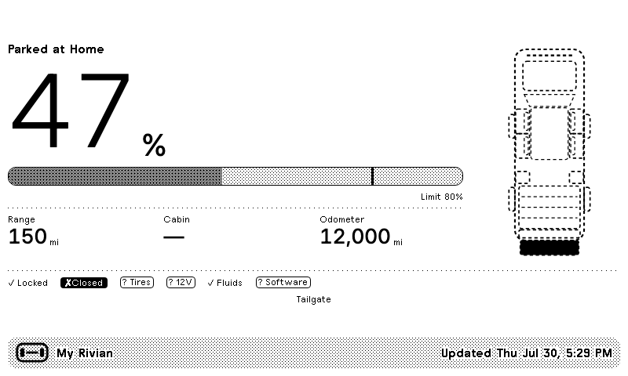
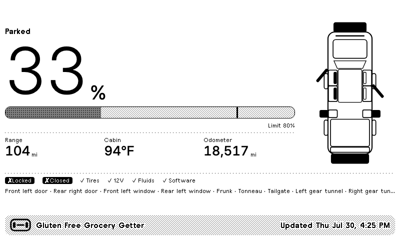

# Rivian for TRMNL

A private [TRMNL](https://trmnl.com) plugin that puts your Rivian's state of charge on
an e-ink dashboard, along with range, cabin temperature, and whether anything is
still open. Data comes from the
[Rivian integration](https://github.com/bretterer/home-assistant-rivian) in Home
Assistant, so nothing but your own hardware ever talks to Rivian.


The screen is deliberately quiet. Everything is fine, so the check row is a line
of ticks and the vehicle diagram is all outline. Leave a window down and the
tailgate up, and the affected panels fill solid while the failing checks invert:


And when the data stops arriving, it says so — which is the entire reason this
plugin is built the way it is:



---

## Before you start

Three things will cost you time or money, and it is better to know now than
after you have wired everything up.

**1. TRMNL's Developer add-on is required, it costs $20, and it is per device.**
Private plugins — the only kind that can receive a webhook — do not exist on a
stock TRMNL account. You need either the Developer add-on or a BYOD/BYOS
licence. The add-on is a one-time $20 purchase **attached to a single device**,
so if you have two TRMNLs and want this on both, that is $20 each. Check your
own status at
<https://trmnl.com/plugin_settings?keyname=private_plugin> before going further.
Nothing in this repository can work around that.

**2. You need Home Assistant**, with the
[bretterer/home-assistant-rivian](https://github.com/bretterer/home-assistant-rivian)
integration installed and a vehicle reporting entities. This plugin is a
presentation layer; it does not talk to Rivian and cannot log in for you.

**3. The upstream integration is partly broken right now, and you have to pin
it.** Rivian changed their API in 2026 in two ways that matter. See
[Upstream status](#upstream-status) — read it before you install, because on an
unpinned version you will get no data at all.

If all three are fine, the rest is about twenty minutes.

---

## What it shows

| | |
|---|---|
| **State of charge** | Large numeral, plus a progress bar with a tick at your charge limit |
| **Range** | Estimated remaining range in your Home Assistant unit |
| **Cabin** | Interior temperature — useful for deciding whether to precondition |
| **Full in** | Time to charge limit while plugged in; swaps to odometer otherwise |
| **Status line** | What it is doing and where — "Charging at Home", "Driving", "In service" |
| **Vehicle diagram** | Top-down schematic; panels open the way they actually open |
| **Health row** | Locked, Closed, Tires, 12V, Fluids, Software — ticked, inverted, or "?" |
| **Last charge** | Once a session ends, what it added — as a caliper under the bar and a figure in kWh |
| **Badges** | Low charge, preconditioning, pet mode, and staleness |

The diagram is drawn from the closure sensors, so it always matches the vehicle. A
flagged tire fills its wheel, and R1S/R3 render without the bed and gear tunnel:

| | |
|---|---|
|  |  |

All four TRMNL sizes are implemented, so the plugin behaves in mashups:

| | |
|---|---|
|  |  |

The title bar shows the name you gave the vehicle in the Rivian app, read from
the Home Assistant device registry, and falls back to the model. The plugin's
**Vehicle Label** custom field overrides both if you want something else.

---

## Honest by design

This is the part worth reading, because it is what the plugin is actually for.

A car dashboard on a wall is glanced at, not studied. That makes it a uniquely
bad place to be quietly wrong: a screen that renders a plausible, confident,
completely stale picture is worse than a blank one, because you will believe it.
Two failure modes cause almost all of that, and both are handled here.

### Unknown is not zero

Home Assistant reports a sensor that did not answer as `unknown` or
`unavailable`. The obvious way to handle that in a template is `| float(0)`, and
it is a trap: a dead integration then renders as **0% charge**, a **"Low charge"
warning**, and **six green ticks** — an urgent-looking dashboard describing a
vehicle nobody is talking to. Nothing on screen says the data is missing,
because as far as the screen knows, it isn't.

So every field travels as one of three things — a value, an explicit "no", or
JSON `null` — and `null` survives all the way to the pixels:

| The sensor said | The screen shows |
|---|---|
| `64` | `64%` |
| `0` | `0%`, with a genuine low-charge warning |
| nothing | `—`, and no warning |
| tyres fine | `✓ Tires` |
| a tyre flagged | `✗ Tires`, inverted |
| tyre sensors silent | `? Tires`, outlined |

A "?" is visibly not a tick and visibly not an alarm. When the closure sensors
have not reported, the vehicle silhouette switches to a **dashed outline**, so the
drawing stops asserting that everything is shut. And a real fault never hides a
gap: the compact views read `1 issue · 3?` rather than just `1 issue`, because
"1 issue" alone would quietly imply the other five checks came back clean.

### Old is not current

TRMNL only regenerates a screen when the merge variables change. That is a good
optimisation and a subtle hazard: if the feed dies, the last image simply
**stays on the wall indefinitely**, pixel-identical to a live one.

It is worth being precise about *why* that is hard to fix, because the obvious
fix does not work. TRMNL deduplicates **at the data layer** — an unchanged
payload is discarded before the render step, so the template is never
re-evaluated. No amount of clever `now`-based Liquid can rescue a screen that is
never re-rendered. There are two genuinely distinct failure cases and they need
two different mechanisms:

- **Home Assistant is alive, the integration is not.** HA measures how long
  since anything last reported and sends it as a coarse, saturating bucket
  (`link_age_min`). Healthy, it is always `0`, so the payload does not churn and
  the e-ink does not redraw. When the feed dies the bucket steps up — which
  makes the payload genuinely *different*, which is the only thing that
  survives deduplication. TRMNL re-renders and a filled `No update 3h` badge
  appears.
- **Home Assistant is dead, and nothing pushes at all.** Nothing can re-render,
  so the last image stays exactly as it was. The only defence is to make sure
  that image was never ambiguous in the first place: **the timestamp always
  carries a date.** `Updated Thu Jul 30, 4:25 PM` reads the same whether it was
  rendered a minute or a fortnight ago. `Updated 4:25 PM` is the bug — rendered
  while perfectly fresh, frozen by the outage, and indistinguishable from live
  at a glance the next afternoon.



Staleness is deliberately kept separate from state. A vehicle can genuinely sit
at a service centre for a week: `In service` is a fact it reported, and it keeps
its place on the status line while the *age* of the reading is carried by its own
badge. Conflating "we know this, and it is old" with "we do not know this" would
be the same mistake in a different coat.

---

## Upstream status

**Read this before installing.** Rivian changed two things in 2026, and the
integration has not fully caught up.

### Location — this one stops everything

`gnssLocation` was removed from Rivian's API in June 2026. Because the
integration requests the whole vehicle state as a single GraphQL subscription,
**one dead field fails the entire subscription** — so the symptom is not "the
map is missing", it is *every entity going unavailable at once*. That is the
failure this plugin's no-data rendering is built around, and it is the most
likely thing you will hit.

The fix is community pull request
[**bretterer/home-assistant-rivian#267**](https://github.com/bretterer/home-assistant-rivian/pull/267)
by **[@cellmechanic](https://github.com/cellmechanic)** — not ours, and credit
where it is due. It is correct and mergeable but not yet released.

**Recommended setup: pin and patch, do not fork.** Install
`1.5.3b0` and apply PR #267 on top of it. When the patch lands upstream, drop
the pin. This repository deliberately does **not** vendor or copy that patch —
take it from the source so you get the author's fixes and history.

### Charging telemetry — not recoverable, and that is fine

Rivian moved live charging telemetry to a system internally called **Parallax**:
protobuf payloads keyed by RVM string, over a GraphQL WebSocket, with charging
now under `charging.session.status` and `charging.session.time_estimation`. This
is a transport *and* encoding change with no public schema — not a field rename.
The `sed` workaround circulating in
[issue #254](https://github.com/bretterer/home-assistant-rivian/issues/254) does
not restore the sensors, and the old `getLiveSessionData` query is not cleanly
fixable. **Do not wait for this one.**

The good news is that it barely matters here, because almost everything on this
screen comes from `vehicleState`, which still works:

| On screen | Source | Status |
|---|---|---|
| Charge %, charge limit | `batteryLevel`, `batteryLimit` | ✅ works |
| Charging / plugged in | `chargerState`, `chargerStatus` | ✅ works |
| Time to charge limit | `timeToEndOfCharge` | ✅ works |
| Range, cabin, odometer, closures, tyres, locks, software | `vehicleState` | ✅ works |
| **Live charge rate (kW)** | live-session query | ❌ dark |
| **Metered session energy (kWh)** | live-session query | ❌ dark |

So the charging display keeps working. The plugin simply **drops the kW figure**
rather than printing `0 kW`, and estimates session energy from the SOC delta
against the pack capacity, marking it with a `~` so an estimate is never
mistaken for a meter reading:


---

## Setup

> **Deploying for the first time?** [`docs/DEPLOYMENT.md`](docs/DEPLOYMENT.md)
> is the step-by-step handoff, including how to verify each step against the
> real screen rather than trusting a `200`.

### 1. Get the Rivian integration working first

Do not start here if Home Assistant is not already showing you Rivian entities.

1. Install [bretterer/home-assistant-rivian](https://github.com/bretterer/home-assistant-rivian)
   via HACS, pinned to `1.5.3b0`, and apply
   [PR #267](https://github.com/bretterer/home-assistant-rivian/pull/267) — see
   [Upstream status](#upstream-status).
2. Complete the Rivian login (it uses an OTP; have your phone).
3. Go to **Developer Tools → States** and filter for `battery_state_of_charge`.
   You should see something like `sensor.r1t_battery_state_of_charge` with a real
   number in it.
4. **Write down the slug** — the bit between the domain and the sensor name. In
   `sensor.r1t_battery_state_of_charge` the slug is `r1t`. It is the single value
   everything else keys off.

If step 3 shows nothing, or shows `unavailable`, stop and fix that first. This
plugin will faithfully report that you have no data, which is correct but not
what you wanted.

### 2. Create the plugin in TRMNL

Requires the Developer add-on or a BYOD licence — see
[Before you start](#before-you-start). The repo uses the
[`trmnlp`](https://github.com/usetrmnl/trmnlp) project layout, so either route
works.

**With trmnlp** — the official CLI, and the easier path if you plan to keep
editing:

```bash
gem install trmnlp
trmnlp login
trmnlp push        # creates the plugin from src/
trmnlp pull        # writes the new plugin's id: back into src/settings.yml
```

Commit the `id:` that `trmnlp pull` adds; without it every push creates a *new*
plugin. `trmnlp serve` gives you a live local preview, and `trmnlp lint` runs the
same checks TRMNL's reviewers use.

**Without trmnlp** — build the archive and import it:

```bash
python3 tools/build_plugin.py     # writes dist/trmnl-rivian.zip
```

Go to **Plugins → Private Plugin → Import** and upload `dist/trmnl-rivian.zip`.

Either way, copy the **Webhook URL** from the plugin's settings afterwards — it
looks like `https://trmnl.com/api/custom_plugins/<uuid>`. **Treat it as a
credential:** anyone holding it can write to your screen.

<details>
<summary>Prefer to paste it in by hand?</summary>

Create a Private Plugin with strategy **Webhook**, then paste
`src/shared.liquid` into the **Shared** tab and each `src/<size>.liquid` into its
matching view tab. The build script exists only because the ZIP importer has no
slot for shared markup — it prepends `shared.liquid` to each view, which is
exactly what TRMNL does with the Shared tab at render time.

</details>

### 3. Send one payload by hand

Do this before touching Home Assistant. It separates "is the plugin right" from
"is the template right".

```bash
curl -X POST "https://trmnl.com/api/custom_plugins/<uuid>" \
  -H "Content-Type: application/json" \
  -d "{\"merge_variables\": $(cat samples/charging.json)}"
```

Open the plugin's markup editor, click **Force Refresh**, and compare against
`preview/full-charging.png`. They should match apart from the instance name.

### 4. Point Home Assistant at it

```yaml
# configuration.yaml
homeassistant:
  packages: !include_dir_named packages
```

```yaml
# secrets.yaml   (never commit this)
trmnl_webhook_url: "https://trmnl.com/api/custom_plugins/<uuid>"
```

Home Assistant needs literal entity ids inside a trigger, so the vehicle slug
appears in several places. Rather than editing them by hand and missing one,
generate the package:

```bash
python3 tools/configure_ha.py --slug r1t --out <config>/packages/trmnl_rivian.yaml
```

It refuses to write if any reference would be left behind. Restart Home
Assistant.

The package declares everything it needs, including an `input_datetime` helper
it uses to enforce the webhook rate limit. You do not have to create anything by
hand.

### 5. Verify

1. **Developer Tools → Template**, paste this and confirm it prints valid JSON
   with sane numbers:
   ```jinja
   {{ state_attr('sensor.rivian_trmnl_payload', 'payload') }}
   ```
   Fields reading `null` mean that entity is not reporting — either the name is
   wrong for your vehicle, or the integration is down. Fix it in the package, not
   in the plugin.
2. **Developer Tools → Actions**, run `script.trmnl_rivian_push`.
3. **Force Refresh** in TRMNL. The screen should show your vehicle.
4. Open a door. Within a few minutes the automation should fire on its own.

---

## How refreshing actually works

Worth understanding, because it is not what you would guess.

**TRMNL is pull-only.** Devices ping the server; the server never pushes. There
is no API to wake a device early — not in the
[OpenAPI spec](https://trmnl.com/api-docs/openapi.yaml), not anywhere. Your
device decides when to redraw based on its own refresh rate (15 min standard,
5 min on TRMNL+). A webhook cannot shorten that.

**But TRMNL only regenerates a screen when the merge variables changed.** If a
push carries data identical to last time, it is dropped *before* the render
step — no new image, and the Liquid never even runs. That is where the control
actually lives:

- **The push is change-driven.** The payload lives in a template sensor, which
  Home Assistant only re-renders when an entity it reads changes.
- **Noisy values are quantised.** Charge power is whole kW and time-to-limit is
  rounded to 5 minutes, so a charger drifting between 11.2 and 11.4 kW produces
  an identical payload and no redraw. Temperatures, range and odometer are whole
  numbers for the same reason.
- **`updated_at` is not the render time.** It is the newest `last_changed` among
  the values on screen. Putting `now()` in a payload makes every push unique,
  defeats deduplication and forces a redraw every single time.

### TRMNL's hard limits

Both are enforced server-side, neither is configurable, and there is no setting
in the TRMNL UI to raise either:

| Limit | Free | TRMNL+ | On breach |
|---|---|---|---|
| Webhook posts | **12 per hour** | 30 per hour | `429` |
| Payload size | **2 kB** | 5 kB | rejected |

The payload this package sends is about 1 kB, and `npm run test:ha` fails the
build if any scenario exceeds 2048 bytes. If you use `deep_merge`, note that the
*merged* result must fit, not just what you sent.

> **A trap worth knowing about.** Turning on **Debug Logs** for a plugin
> temporarily raises the rate limit. If you calibrate your push interval while
> they are on, everything looks fine — and then starts returning `429`s when
> they expire a day later, with nothing on your side having changed. Set the
> throttle from the numbers below, not from what you can get away with today.

### Rate limiting, and why it queues

The package enforces a **minimum gap of 330 seconds** between sends. The
arithmetic, since getting this wrong is a delayed failure:

- A hard minimum gap of `g` seconds admits `floor(3600/g) + 1` sends in any
  rolling hour — the `+ 1` because a window can capture both endpoints.
- At `g = 330`: `floor(3600/330) + 1 = 10 + 1 = **11**`. One push of headroom
  under the cap of 12.
- At the previous `g = 290`: `floor(3600/290) + 1 = 12 + 1 = **13**`. Over the
  cap, which is what earned the `429`s. Even its steady-state rate,
  `3600/290 = 12.4/hour`, was already above 12.

**The 30-minute heartbeat does not add to that total.** Every send — priority,
routine and heartbeat alike — funnels through one `mode: queued` script that
holds the gap, so the heartbeat can at most *occupy* one of the 11 slots rather
than adding a twelfth. That is the reason the throttle lives in the script and
not in each automation: two independent throttles cannot be reasoned about
together, and the earlier design's heartbeat sat outside the count.

Pushes are split by importance rather than simply dropped:

- **Priority** — anything you would act on: unlocked, something opened, charging
  started, the feed went dark. These *queue*: they wait out the rate-limit window
  instead of being discarded, so a tailgate left open is never silently held back
  for half an hour.
- **Routine** — cosmetic drift like SOC ticking 64 → 65. Dropped if the window
  has not elapsed, and rides along on the next push.

Both feed one queued script that reads the payload *after* its delay, so a
queued push always sends the newest state and rapid changes coalesce into one
accurate screen. On TRMNL+ you can lower the gap to 130 s.

---

## Data contract

The webhook posts a flat `merge_variables` object, ~1 kB against TRMNL's 2 kB
limit. **Any field may be `null`**, meaning the sensor did not report — which is
not the same as `0` or `false`, and the views render it differently.

```json
{
  "vehicle": "My Rivian",
  "model": "R1T",
  "body_style": "truck",
  "soc": 64,
  "soc_limit": 80,
  "range": 200,
  "distance_unit": "mi",
  "cabin_temp": 70,
  "temp_unit": "F",
  "odometer": 12000,
  "gear": "Park",
  "location": "Home",
  "driving": false,
  "service_mode": false,
  "locked": true,
  "plugged_in": true,
  "charging": true,
  "charge_power": null,
  "charge_eta_min": 95,
  "preconditioning": false,
  "pet_mode": false,

  "door_fl": false, "door_fr": false, "door_rl": false, "door_rr": false,
  "win_fl": true,   "win_fr": false,  "win_rl": false,  "win_rr": false,
  "frunk": false, "tonneau": false, "tailgate": true,
  "tunnel_l": false, "tunnel_r": false,

  "tire_fl": true, "tire_fr": true, "tire_rl": true, "tire_rr": true,
  "battery_12v_ok": true,
  "fluids_ok": true,
  "software_ok": true,

  "last_charge_start_soc": 40,
  "last_charge_end_soc": 80,
  "last_charge_kwh": 45.0,
  "last_charge_kwh_est": false,
  "last_charge_at": "2026-07-30T04:20:00-0700",
  "moved_since_charge": false,

  "updated_at": "2026-07-30T14:32:00-0700",
  "link_age_min": 0
}
```

Anything that produces this shape works — Home Assistant is just the convenient
source. Notes on the less obvious fields:

- **Closures** are per-position booleans rather than lists, because the diagram
  needs to know *which* panel to fill; the human-readable lists are derived in
  Liquid.
- **`body_style`** is `truck` or `suv`.
- **`_ok` booleans** are true when healthy. `null` renders as `?`, never as a
  tick.
- **`location`** is a zone name from Home Assistant, blank when the vehicle is
  somewhere unnamed. Rename your zones and the screen follows.
- **`updated_at`** is "data as of" — the newest change among the values shown,
  not the render time.
- **`link_age_min`** is minutes since the integration last reported *anything*,
  bucketed to `0, 30, 60, 180, 360, 720, 1440, 2880`. `0` is healthy. This is
  the field that lets a dead feed announce itself; see
  [Honest by design](#honest-by-design).
- **`last_charge_kwh_est`** marks the kWh figure as derived from SOC and pack
  capacity rather than metered. Shown with a `~`.

The last-charge block is only rendered while it still describes the charge in
the battery: not charging now, and not driven since — decided by comparing the
odometer against a snapshot taken when the session ended.

Three optional fields, settable either in the payload or as plugin custom fields
in TRMNL:

- `vehicle_label` — overrides the title bar name.
- `logo_url` — replaces the title bar mark with an image of your choosing.
- `vehicle_image_url` — replaces the diagram with a dithered photo. TRMNL renders
  server-side, so this must be a URL TRMNL's renderer can reach; Home Assistant's
  own image entities are behind a token'd local URL and will not work. Note the
  trade-off: a photo cannot show which door is open, which is most of what the
  diagram is for.

---

## Troubleshooting

| Symptom | Cause and fix |
|---|---|
| Screen shows `—` and every check is `?` | The integration is not reporting. Check **Developer Tools → States** for your Rivian entities — most likely the whole `vehicleState` subscription is down; see [Upstream status](#upstream-status). The screen is correct; the data is missing. |
| A filled `No update 3h` badge | The feed stopped. Same check as above. If Home Assistant itself was restarted, it clears on the next push. |
| Screen never updates | TRMNL skips regeneration when merge variables are identical. Click **Force Refresh** to confirm it is not simply unchanged. |
| Screen blank after import | No webhook received yet. Do [step 3](#3-send-one-payload-by-hand). |
| Everything reads `null` in the template preview | Wrong slug. Re-check [step 1](#1-get-the-rivian-integration-working-first). |
| Some fields `null`, others fine | Those specific entities do not exist for your vehicle. Correct the names in `homeassistant/trmnl_rivian.yaml`. |
| No `kW` while charging | Expected — the live-session query is dark upstream. ETA and charge % still work. |
| `~` before the kWh figure | Also expected: an estimate from SOC × capacity, not a meter reading. |
| "Unlocked" while actually locked | `locked_state` is a LOCK sensor where `on` means unlocked. The package inverts it; if it is wrong, it is inverted twice. |
| `429` from the webhook | Rate limit. The gap is 330 s in the push script; raise it. |
| Layout reflowed oddly | Framework drift. `framework_version` is pinned in `src/settings.yml`. |
| Import rejected | Try `framework_version: latest` in `src/settings.yml`. |

---

## Local development

Two harnesses, for different jobs. `trmnlp serve` is the official live preview —
edit `src/` and the browser reloads. The scripts here render the exact device
bitmap and check the Home Assistant side, which `trmnlp` does not cover:

```bash
npm install
npm run setup            # mirror the TRMNL framework bundle into vendor/ (~26 MB)
npm run preview -- --view full --sample everything
npm run check            # lint, both test suites, every render, build the zip
```

| | |
|---|---|
| `npm test` | 389 contract assertions over every view and sample |
| `npm run test:ha` | 146 assertions over the Home Assistant template and the priority fingerprint |
| `npm run lint:ha` | confirms the package names one vehicle slug consistently |
| `npm run preview:all` | 48 renders into `preview/` |
| `npm run build` | writes `dist/trmnl-rivian.zip` |

```bash
node tools/render.mjs --view quadrant --sample low --device v2 --dark
```

- `--view` `full` · `half_horizontal` · `half_vertical` · `quadrant`
- `--sample` any file in `samples/`
- `--device` `og` (800×480) · `v2` (1040×780)
- `--dark` render in TRMNL's dark mode

`tools/render.mjs` renders Liquid through TRMNL's own public
[`/api/markup`](https://docs.trmnl.com/go/private-api/introduction) endpoint —
so custom filters and whitespace control behave exactly as they will in
production — then screenshots the result in Chromium at true device size against
the real `plugins.css`.

### The tests are the point

`tools/test_views.mjs` asserts behaviour rather than pixels, and it checks the
unknown-handling **in both directions**. An earlier version of this suite tested
only that a sparse payload invents no *alarm* — which it did not, because it
rendered six green ticks instead. A suite that passes while the dashboard lies
is worse than no suite. So an empty payload must now produce neither a `✗` nor a
`✓`, and there are targeted regressions for each specific way the old build
lied: a dead lock sensor reading as "locked", absent closures ticking "Closed",
a genuine `0%` still warning correctly.

`tools/check_ha_template.py` renders the Home Assistant Jinja against eight
stubbed entity tables — healthy, SOC-only, entirely absent, entirely
`unavailable`, live-session-dark, link-gone-quiet, and two for the 12V entity
name. Its central assertion is generic: with no entities, **every** vehicle field
must be JSON `null`, so a newly added field cannot quietly reintroduce the
coercion. It writes `samples/from-ha.json`, which renders like any other sample.

Fixtures store ages relatively (`_age_min`) rather than as fixed timestamps, so
the previews in this repo do not slowly rot into showing `No update 400d`.

---

## Notes for anyone editing this

**Layout.** `src/` holds the plugin itself and follows the `trmnlp` convention:
one `.liquid` per view size, plus `shared.liquid` and `settings.yml`. Everything
else — `tools/`, `samples/`, `homeassistant/` — is this repo's own scaffolding
and is ignored by `trmnlp push`.

**Three states, not two.** The single rule the Liquid obeys: `nil` is neither
`true` nor `false`. Liquid's `default` filter cannot help — it treats `false` as
blank, so `false | default: true` returns `true` — so every test is an explicit
`== nil`, `== true` or `== false`. If you add a field, add it to the `NULLABLE`
list in `tools/check_ha_template.py` and the generic assertion will cover it.

**The framework.** The plugin sticks to TRMNL primitives — `value`, `label`,
`progress-bar`, `divider`, `grid`, `flex` — plus one custom CSS rule for the
charge-limit tick, which has no framework equivalent. It uses `currentColor` so
it inverts correctly in dark mode. Things that cost real debugging time:

- `gap--distribute` sets `justify-content: space-between`, but grid children can
  override it. `flex--between` is the reliable choice inside `col--span-*`.
- `label--gray` is a dither pattern. At `label--small` on a 1-bit display it is
  close to unreadable, so the compact views use plain `label--small`.
- TRMNL's Liquid has no working array append — the `push` filter silently
  returns an empty array. Lists are built as delimited strings and `split` at the
  end.
- `` emits raw HTML, which is how the SVG diagram is built once in
  `src/shared.liquid` and reused by every view.
- `✓` (`&#10003;`) and `✗` (`&#10007;`) render in every framework font,
  including the pixel ones. Most decorative glyphs do not — test before relying
  on one.
- `'now' | date: '%s'` works, which is what makes render-time staleness possible.

**The Rivian integration.** Two things to watch.

*Polarity.* Closure sensors are `DOOR`/`WINDOW` classed, so `on` means *open*.
But `locked_state` is `LOCK` classed with `on_value="unlocked"`, so `on` means
**unlocked** — the inverse of what it reads like. `wiper_fluid_level` is a
`PROBLEM` sensor with `negate`, so `on` means *not normal*.

*Entity ids come from display names, not internal keys.* This one cost a bug:
the 12V health sensor's key is `twelve_volt_battery_health` but its name is
"12V Battery Health", so the entity is `sensor.<slug>_12v_battery_health`. The
package previously read the key spelling, matched nothing, and the 12V check
passed green forever — a check that could never fail, which is the worst kind.
All 30 entity names are now verified against the integration's source.

Two heuristics are worth tuning against your own vehicle, since the integration
does not document their vocabularies: tire pressure status is healthy unless it
falls outside a known-good list, and 12V battery health is healthy unless it
matches a known-bad list. Neither treats a silent sensor as healthy.

---

## Other states

| | |
|---|---|
|  |  |
|  |  |

---

## Credits and licence

- The Home Assistant integration this depends on is
  [bretterer/home-assistant-rivian](https://github.com/bretterer/home-assistant-rivian).
- The location fix everyone currently needs is
  [PR #267](https://github.com/bretterer/home-assistant-rivian/pull/267) by
  [@cellmechanic](https://github.com/cellmechanic).
- [MIT licensed](LICENSE). Not affiliated with Rivian Automotive or TRMNL; the
  title-bar mark is an original glyph, not the Rivian trademark.
