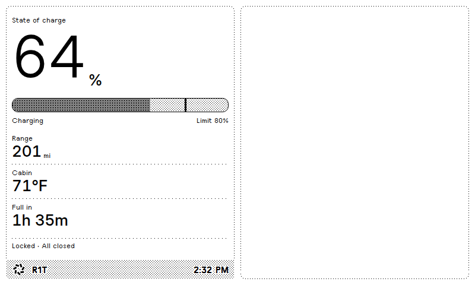
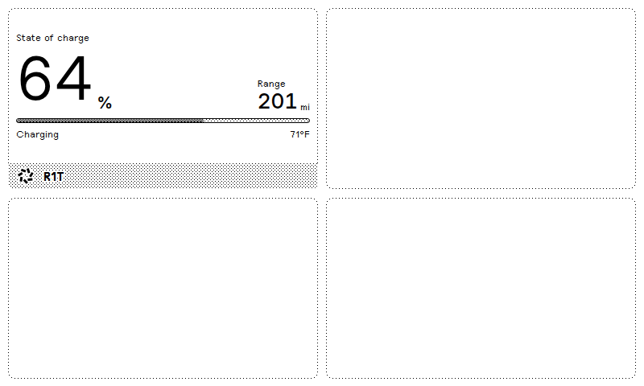

# Rivian for TRMNL

A private [TRMNL](https://trmnl.com) plugin that puts your truck's state of charge on
an e-ink dashboard, along with range, cabin temperature, and whether anything is
still open. Data comes from the
[Rivian integration](https://github.com/bretterer/home-assistant-rivian) in Home
Assistant, so nothing but your own hardware ever talks to Rivian.


The screen is deliberately quiet. When the truck is locked and buttoned up, the
closure row just reads `Closed`. When it isn't, the open items invert and become
the loudest thing on the display:


All four TRMNL sizes are implemented, so the plugin behaves in mashups:

| | |
|---|---|
|  |  |

## What it shows

| | |
|---|---|
| **State of charge** | Large numeral, plus a progress bar with a tick at your charge limit |
| **Range** | Estimated remaining range in your Home Assistant unit |
| **Cabin** | Interior temperature — useful for deciding whether to precondition |
| **Full in** | Time to charge limit while plugged in; swaps to odometer otherwise |
| **Doors / Windows / Storage** | Named individually when open, `Closed` when not |
| **Security** | Locked or unlocked |
| **Badges** | Low charge, preconditioning, pet mode, tire pressure |

## Setup

### 1. Create the plugin in TRMNL

Private plugins need the Developer add-on or a BYOD license.

Build the archive and import it:

```bash
python3 tools/build_plugin.py     # writes dist/trmnl-rivian.zip
```

Then go to **Plugins → Private Plugin → Import**, upload `dist/trmnl-rivian.zip`,
and save. Copy the **Webhook URL** from the plugin's settings — it looks like
`https://trmnl.com/api/custom_plugins/<uuid>`.

<details>
<summary>Prefer to set it up by hand?</summary>

Create a Private Plugin with strategy **Webhook**, then paste
`plugin/shared.liquid` into the **Shared** tab and each `plugin/<size>.liquid`
into its matching view tab. The build script exists only because the importer
has no slot for shared markup — it prepends `shared.liquid` to each view, which
is exactly what TRMNL does with the Shared tab at render time.

</details>

### 2. Point Home Assistant at it

Copy the package and add your webhook URL:

```bash
cp homeassistant/trmnl_rivian.yaml <config>/packages/trmnl_rivian.yaml
```

```yaml
# configuration.yaml
homeassistant:
  packages: !include_dir_named packages
```

```yaml
# secrets.yaml
trmnl_webhook_url: "https://trmnl.com/api/custom_plugins/<uuid>"
```

Open `packages/trmnl_rivian.yaml` and set `vehicle` to your vehicle's entity
slug — whatever prefixes your Rivian entities. Check **Developer Tools → States**
for `battery_state_of_charge`; if the entity is
`sensor.r1t_battery_state_of_charge`, the slug is `r1t`. Update the entity list
in the automation trigger to match, then restart Home Assistant.

To push immediately rather than waiting for the next trigger, run
`rest_command.trmnl_rivian_push` from **Developer Tools → Actions**.

### 3. Rate limits

TRMNL accepts 12 webhooks/hour (30 on TRMNL+). The automation pushes on a
15-minute heartbeat plus meaningful state changes — doors, windows, lock,
charging — throttled to at most one push every 5 minutes. That stays under the
free-tier limit even on a busy afternoon.

## Data contract

The webhook posts a flat `merge_variables` object, ~460 bytes:

```json
{
  "vehicle": "R1T",
  "soc": 64,
  "soc_limit": 80,
  "range": 200,
  "distance_unit": "mi",
  "cabin_temp": 70,
  "temp_unit": "F",
  "odometer": 12000,
  "gear": "Park",
  "locked": true,
  "plugged_in": true,
  "charging": true,
  "charge_power": 11.2,
  "charge_eta_min": 95,
  "preconditioning": false,
  "pet_mode": false,
  "tire_alert": false,
  "doors_open": [],
  "windows_open": ["Front left"],
  "storage_open": ["Tailgate"],
  "updated_at": "2026-07-30T14:32:00-0700"
}
```

Anything that produces this shape works — Home Assistant is just the convenient
source. `doors_open` / `windows_open` / `storage_open` hold display labels, so
they read straight onto the screen.

## Local development

```bash
npm install
npm run setup            # mirror the TRMNL framework bundle into vendor/ (~26 MB)
npm run preview -- --view full --sample open
npm run check            # validate the HA template, render every view, build the zip
```

`tools/render.mjs` renders Liquid through TRMNL's own public
[`/api/markup`](https://docs.trmnl.com/go/private-api/introduction) endpoint —
so custom filters and whitespace control behave exactly as they will in
production — then screenshots the result in Chromium at true device size against
the real `plugins.css`.

```bash
node tools/render.mjs --view quadrant --sample low --device v2 --dark
```

- `--view` `full` · `half_horizontal` · `half_vertical` · `quadrant`
- `--sample` any file in `samples/`
- `--device` `og` (800×480) · `v2` (1040×780)
- `--dark` render in TRMNL's dark mode

`tools/check_ha_template.py` renders the Home Assistant Jinja against a stubbed
entity table, so a typo in the payload template surfaces without a round trip
through a live HA instance. It writes `samples/from-ha.json`, which you can then
render like any other sample.

## Layout notes

The plugin sticks to TRMNL's framework primitives — `value`, `label`, `progress-bar`,
`divider`, `grid`, `flex` — and adds exactly one custom CSS rule: the tick that
marks the charge limit on the progress track, which has no framework equivalent.
It uses `currentColor` so it inverts correctly in dark mode.

Two things worth knowing if you edit the markup:

- `gap--distribute` sets `justify-content: space-between`, but grid children can
  override it. `flex--between` is the reliable choice inside `col--span-*`.
- `label--gray` is a dither pattern. At `label--small` on a 1-bit display it is
  close to unreadable, so the compact views use plain `label--small` instead.

## Other states

| | |
|---|---|
|  |  |
