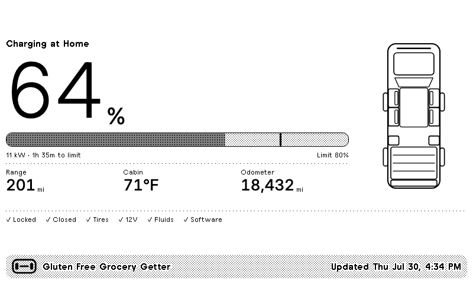
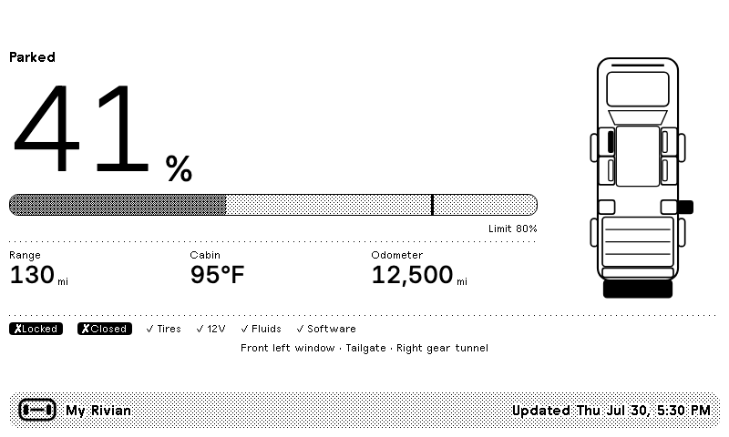
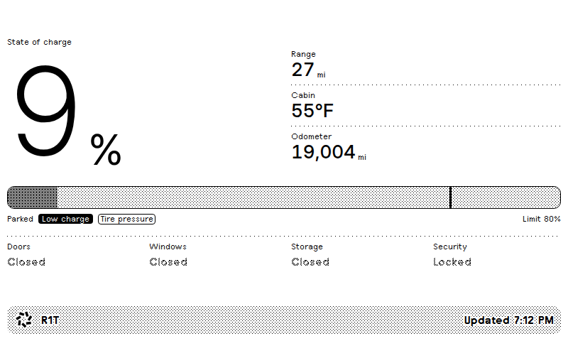
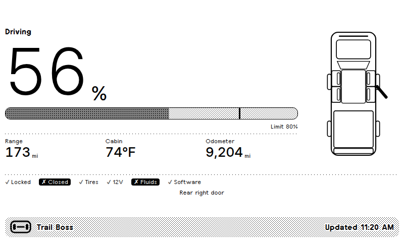
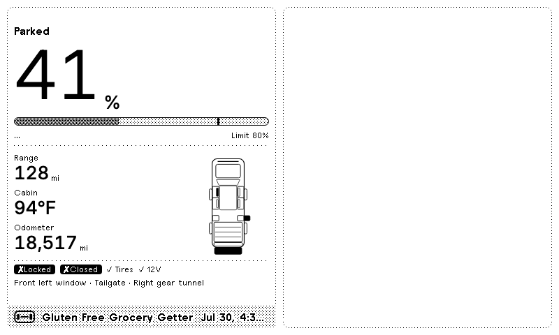
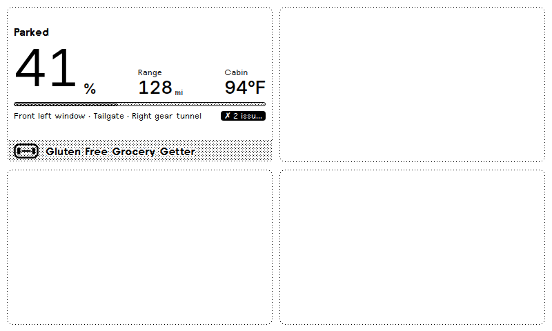
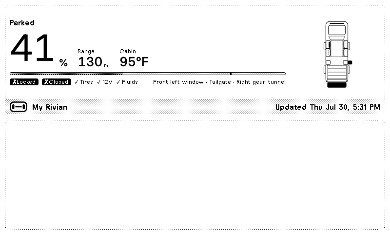
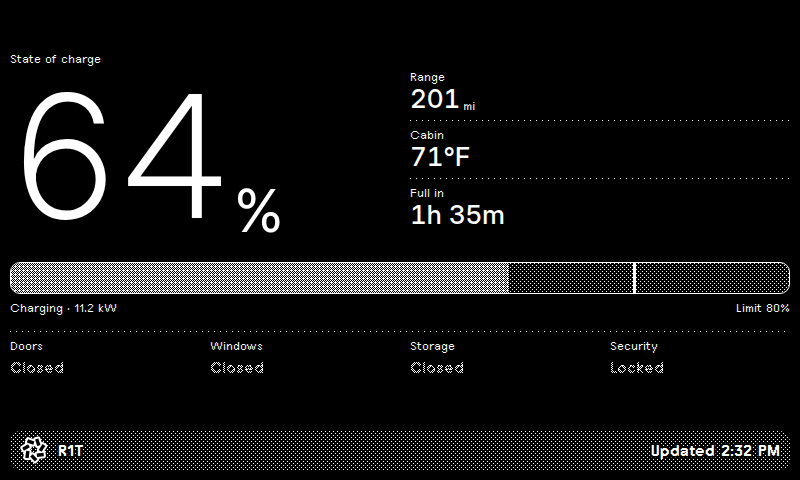

# Rivian for TRMNL

A private [TRMNL](https://trmnl.com) plugin that puts your truck's state of charge on
an e-ink dashboard, along with range, cabin temperature, and whether anything is
still open. Data comes from the
[Rivian integration](https://github.com/bretterer/home-assistant-rivian) in Home
Assistant, so nothing but your own hardware ever talks to Rivian.



The screen is deliberately quiet. Everything is fine, so the check row is a line
of ticks and the truck diagram is all outline. Leave a window down and the
tailgate up, and the affected panels fill solid while the failing checks invert:



The diagram is drawn from the closure sensors, so it always matches the truck. A
flagged tire fills its wheel, and R1S/R3 render without the bed and gear tunnel:

| | |
|---|---|
|  |  |

All four TRMNL sizes are implemented, so the plugin behaves in mashups:

| | |
|---|---|
|  |  |

## What it shows

| | |
|---|---|
| **State of charge** | Large numeral, plus a progress bar with a tick at your charge limit |
| **Range** | Estimated remaining range in your Home Assistant unit |
| **Cabin** | Interior temperature — useful for deciding whether to precondition |
| **Full in** | Time to charge limit while plugged in; swaps to odometer otherwise |
| **Status line** | What it is doing and where — "Charging at Home", "Driving", "In service" |
| **Vehicle diagram** | Top-down schematic; panels open the way they actually open |
| **Health row** | Locked, Closed, Tires, 12V, Fluids, Software — ticked or inverted |
| **Last charge** | Once a session ends, what it added — as a caliper under the bar and a figure in kWh |
| **Badges** | Low charge, preconditioning, pet mode |

The title bar shows the name you gave the vehicle in the Rivian app, read from
the Home Assistant device registry, and falls back to the model. The plugin's
**Vehicle Label** custom field overrides both if you want something else.

## Setup

> **Deploying for the first time?** [`docs/DEPLOYMENT.md`](docs/DEPLOYMENT.md) is
> the step-by-step handoff — what is verified, what is still guesswork, and how
> to check each step. Nothing here has run against a live account yet.

### 1. Create the plugin in TRMNL

Private plugins need the Developer add-on or a BYOD license. The repo uses the
[`trmnlp`](https://github.com/usetrmnl/trmnlp) project layout, so either route
works.

**With trmnlp** — the official CLI, and the easier path if you plan to keep
editing:

```bash
gem install trmnlp
trmnlp login
trmnlp push        # creates the plugin from src/
```

Run `trmnlp pull` once afterwards so `src/settings.yml` picks up an `id:`;
without it every push creates a new plugin. `trmnlp serve` gives you a live
local preview, and `trmnlp lint` runs the same checks TRMNL's reviewers use.

**Without trmnlp** — build the archive and import it:

```bash
python3 tools/build_plugin.py     # writes dist/trmnl-rivian.zip
```

Go to **Plugins → Private Plugin → Import** and upload `dist/trmnl-rivian.zip`.

Either way, copy the **Webhook URL** from the plugin's settings afterwards — it
looks like `https://trmnl.com/api/custom_plugins/<uuid>`.

<details>
<summary>Prefer to paste it in by hand?</summary>

Create a Private Plugin with strategy **Webhook**, then paste
`src/shared.liquid` into the **Shared** tab and each `src/<size>.liquid` into its
matching view tab. The build script exists only because the ZIP importer has no
slot for shared markup — it prepends `shared.liquid` to each view, which is
exactly what TRMNL does with the Shared tab at render time.

</details>

### 2. Point Home Assistant at it

Copy the package and add your webhook URL:

```yaml
# configuration.yaml
homeassistant:
  packages: !include_dir_named packages
```

```yaml
# secrets.yaml
trmnl_webhook_url: "https://trmnl.com/api/custom_plugins/<uuid>"
```

Home Assistant needs literal entity ids inside a trigger, so the vehicle slug
appears in several places. Rather than editing them by hand, generate the
package:

```bash
python3 tools/configure_ha.py --slug r1t --out <config>/packages/trmnl_rivian.yaml
```

Your slug is whatever prefixes your Rivian entities — check **Developer Tools →
States** for `battery_state_of_charge`; if the entity is
`sensor.r1t_battery_state_of_charge`, the slug is `r1t`. Restart Home Assistant.

To push immediately rather than waiting for a change, run
`rest_command.trmnl_rivian_push` from **Developer Tools → Actions** with
`body: {{ state_attr('sensor.rivian_trmnl_payload','payload') }}`.

## How refreshing actually works

Worth understanding, because it is not what you would guess:

**TRMNL is pull-only.** Devices ping the server; the server never pushes. There
is no API to wake a device early — not in the
[OpenAPI spec](https://trmnl.com/api-docs/openapi.yaml), not anywhere. Your
device decides when to redraw, based on its own refresh rate (15 min standard,
5 min on TRMNL+). A webhook cannot shorten that.

**But TRMNL only regenerates a screen when the merge variables changed.** If a
push carries data identical to last time, no new image is rendered and the panel
does not redraw. That is where the control actually lives, and this package uses
it deliberately in two ways:

- **The push itself is change-driven.** The payload lives in a template sensor,
  which Home Assistant only re-renders when an entity it reads changes. The
  automation fires on that attribute changing, so a webhook goes out when the
  truck's state changes rather than on a timer. The 30-minute time pattern is
  just insurance against a dropped request.

- **Noisy values are quantised**, exactly the concern you raised about charge
  rate. Charge power is rounded to whole kW and time-to-full to the nearest
  5 minutes, so a charger drifting between 11.2 and 11.4 kW produces an
  identical payload and no redraw. Temperatures, range and odometer are whole
  numbers for the same reason.

One subtle trap this avoids: putting `now()` in the payload. A render timestamp
changes on every push, which makes every payload unique, which defeats TRMNL's
deduplication and forces a redraw every single time. The `updated_at` field is
instead the newest `last_changed` among the values on screen — so it means "data
as of", and it holds still while the truck does.

TRMNL accepts 12 webhooks/hour (30 on TRMNL+); pushes are throttled to at most
one every 5 minutes.

## Data contract

The webhook posts a flat `merge_variables` object, ~800 bytes:

```json
{
  "vehicle": "Gluten Free Grocery Getter",
  "model": "R1T",
  "body_style": "truck",
  "soc": 64,
  "soc_limit": 80,
  "range": 201,
  "distance_unit": "mi",
  "cabin_temp": 71,
  "temp_unit": "F",
  "odometer": 18432,
  "gear": "Park",
  "location": "Home",
  "driving": false,
  "service_mode": false,
  "locked": true,
  "plugged_in": true,
  "charging": true,
  "charge_power": 11,
  "charge_eta_min": 95,
  "preconditioning": false,
  "pet_mode": false,

  "door_fl": false, "door_fr": false, "door_rl": false, "door_rr": false,
  "win_fl": true,   "win_fr": false,  "win_rl": false,  "win_rr": false,
  "frunk": false, "tonneau": false, "tailgate": true,
  "tunnel_l": false, "tunnel_r": false,

  "tire_fl": true, "tire_fr": true, "tire_rl": true, "tire_rr": true,
  "battery_12v_ok": true,
  "fluids_ok": true,
  "software_ok": true,

  "last_charge_start_soc": 39,
  "last_charge_end_soc": 80,
  "last_charge_kwh": 44.8,
  "last_charge_at": "2026-07-30T04:20:00-0700",
  "moved_since_charge": false,

  "updated_at": "2026-07-30T14:32:00-0700"
}
```

Anything that produces this shape works — Home Assistant is just the convenient
source. Closures are per-position booleans rather than lists because the diagram
needs to know *which* panel to fill; the human-readable lists are derived in
Liquid. `body_style` is `truck` or `suv`. Booleans ending in `_ok` are true when
healthy, so a missing field never invents an alarm. `location` is a zone name
from Home Assistant and is blank when the truck is somewhere unnamed — rename
your zones and the screen follows.

The last-charge block is only rendered when it still describes the charge in the
battery: not charging now, and not driven since. `moved_since_charge` is decided
by comparing the odometer against a snapshot taken when the session ended, so
one drive retires it.

Three optional fields, settable either in the payload or as plugin custom
fields in TRMNL:

- `vehicle_label` — overrides the title bar name.
- `logo_url` — replaces the title bar mark with an image of your choosing.
- `vehicle_image_url` — replaces the diagram with a dithered photo. TRMNL renders
  server-side, so this must be a URL TRMNL's renderer can reach; Home Assistant's
  own image entities are behind a token'd local URL and will not work. Note the
  trade-off: a photo cannot show which door is open, which is most of what the
  diagram is for.

## Local development

Two harnesses, for different jobs. `trmnlp serve` is the official live preview —
edit `src/` and the browser reloads. The scripts here render the exact device
bitmap and check the Home Assistant side, which `trmnlp` does not cover:

```bash
npm install
npm run setup            # mirror the TRMNL framework bundle into vendor/ (~26 MB)
npm run preview -- --view full --sample everything
npm run check            # lint, both test suites, every render, build the zip
```

| | |
|---|---|
| `npm test` | 204 contract assertions over every view and sample |
| `npm run test:ha` | 52 assertions over the Home Assistant template, across three entity tables |
| `npm run lint:ha` | confirms the package names one vehicle slug consistently |
| `npm run preview:all` | 32 renders into `preview/` |
| `npm run build` | writes `dist/trmnl-rivian.zip` |

`tools/render.mjs` renders Liquid through TRMNL's own public
[`/api/markup`](https://docs.trmnl.com/go/private-api/introduction) endpoint —
so custom filters and whitespace control behave exactly as they will in
production — then screenshots the result in Chromium at true device size against
the real `plugins.css`.

```bash
node tools/render.mjs --view quadrant --sample low --device v2 --dark
```

- `--view` `full` · `half_horizontal` · `half_vertical` · `quadrant`
- `--sample` any file in `samples/`
- `--device` `og` (800×480) · `v2` (1040×780)
- `--dark` render in TRMNL's dark mode

`tools/test_views.mjs` renders every view through TRMNL's real Liquid and
asserts behaviour rather than pixels — no view errors, nothing leaks an
unrendered tag, and, most importantly, **a sparse payload never invents an
alarm**. A truck that has not reported yet must read as "nothing to report", not
as one with four flat tires and the doors unlocked.

`tools/check_ha_template.py` renders the Home Assistant Jinja against stubbed
entity tables — a healthy vehicle, one reporting only a state of charge, and
none at all — and asserts the result — that a `Low` tire reads as flagged, that a
mismatched OTA version reads as an update pending, that `locked_state: off`
reads as *locked*. A typo or a flipped sensor surfaces without a round trip
through a live HA instance. It writes `samples/from-ha.json`, which you can then
render like any other sample.

## Notes for anyone editing this

**Layout.** `src/` holds the plugin itself and follows the `trmnlp` convention:
one `.liquid` per view size, plus `shared.liquid` and `settings.yml`. Everything
else — `tools/`, `samples/`, `homeassistant/` — is this repo's own scaffolding
and is ignored by `trmnlp push`.

**The framework.** The plugin sticks to TRMNL primitives — `value`, `label`,
`progress-bar`, `divider`, `grid`, `flex` — plus one custom CSS rule for the
charge-limit tick, which has no framework equivalent. It uses `currentColor` so
it inverts correctly in dark mode. Things that cost real debugging time:

- `gap--distribute` sets `justify-content: space-between`, but grid children can
  override it. `flex--between` is the reliable choice inside `col--span-*`.
- `label--gray` is a dither pattern. At `label--small` on a 1-bit display it is
  close to unreadable, so the compact views use plain `label--small`.
- TRMNL's Liquid has no working array append — the `push` filter silently
  returns an empty array. Lists are built as delimited strings and `split` at the
  end.
- `` emits raw HTML, which is how the SVG diagram is built once in
  `src/shared.liquid` and reused by every view.
- `✓` (`&#10003;`) and `✗` (`&#10007;`) render in every framework font,
  including the pixel ones. Most decorative glyphs do not — test before relying
  on one.

**The Rivian integration.** Polarity is the thing to watch. Closure sensors are
`DOOR`/`WINDOW` classed, so `on` means *open*. But `locked_state` is `LOCK`
classed with `on_value="unlocked"`, so `on` means **unlocked** — the inverse of
what it reads like. `wiper_fluid_level` is a `PROBLEM` sensor with `negate`, so
`on` means *not normal*.

Two heuristics are worth tuning against your own truck, since the integration
does not document their vocabularies: tire pressure status is treated as healthy
unless it falls outside a known-good list, and 12V battery health is treated as
healthy unless it matches a known-bad list. Both fail safe — an unknown or
unavailable reading will not raise a false alarm.

## Other states

| | |
|---|---|
|  |  |
